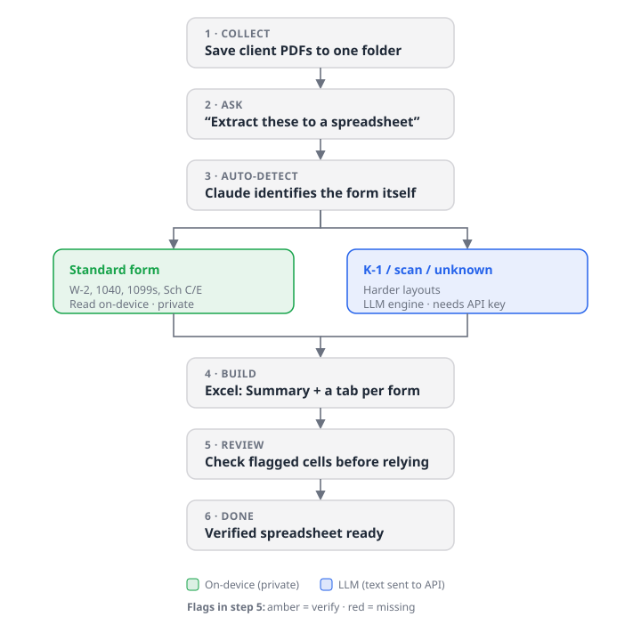

# Tax Form to Excel

Turn tax-form PDFs (W-2, 1040, 1099-NEC/MISC/INT/DIV/R, Schedule C/E, K-1) into
a formatted Excel workbook. It detects the form type, splits combined packets,
and flags low-confidence values for review. Runs locally. Use it as an agent
skill (`SKILL.md`), as an MCP server in Claude Desktop / Claude Code, from the
command line, or by dragging PDFs onto a Windows icon.



```
PDF ─▶ text (pdfplumber, OCR fallback) ─▶ split packet ─▶ detect form ─▶ extract fields ─▶ Excel (openpyxl)
```

## What it does

- **Auto-detects** each form and extracts the key fields into a workbook: a
  Summary tab plus one detail tab per form.
- **Splits combined packets.** One PDF with a 1040 plus schedules and K-1s
  becomes separate forms.
- **Flags for review.** Low-confidence cells are amber and missing ones red.
  *This is an extraction aid, not a filing tool. Always verify the numbers.*
- **Local by default.** Nothing leaves the machine. An optional LLM engine
  (Anthropic API) handles messy K-1s and unknown layouts but sends text
  off-device.

## Install

```bash
pip install -r requirements.txt
```

Optional: `anthropic` (LLM engine), `pytesseract` + `pdf2image` (OCR for
scans), `reportlab` (regenerate sample PDFs).

## Four ways to use it

1. **Agent skill.** Drop this folder into your agent's skills directory
   (e.g. `~/.claude/skills/tax-form-to-excel/`). The agent follows `SKILL.md`.
2. **MCP server `tax-form-to-excel`.** Say "extract these to a spreadsheet" in
   Claude. Setup: [references/claude-desktop-setup.md](references/claude-desktop-setup.md).
3. **Command line**
   ```bash
   python scripts/cli.py myW2.pdf -o out.xlsx
   python scripts/cli.py ./client_pdfs/ -o 2025_summary.xlsx
   ```
4. **Windows drag-and-drop.** Drop PDFs onto `windows/Extract PDF (drag here).bat`.
   Workbooks land in `Extracted workbooks/`.

Try it with the bundled fake data:

```bash
python scripts/cli.py assets/sample_w2.pdf -o demo_w2.xlsx
```

## Layout

```
SKILL.md                 agent instructions (Agensi / Claude Code / Codex)
README.md                this file
requirements.txt
scripts/                 cli.py, mcp_server.py, make_sample.py, tax_extractor/
references/              setup guide; forms, engines, limits, extending
assets/                  sample PDFs (fake data), workflow diagram
windows/                 drag-and-drop and installer .bat files
dev/                     maintainer-only helpers (not part of the skill)
```

More detail: [references/forms-and-engines.md](references/forms-and-engines.md).

## Privacy

Tax forms contain SSNs, EINs, names, and wages. The default engine and OCR run
entirely on your machine. Client-data folders (`Drop tax forms here/`,
`Extracted workbooks/`) are git-ignored and must never be committed.
